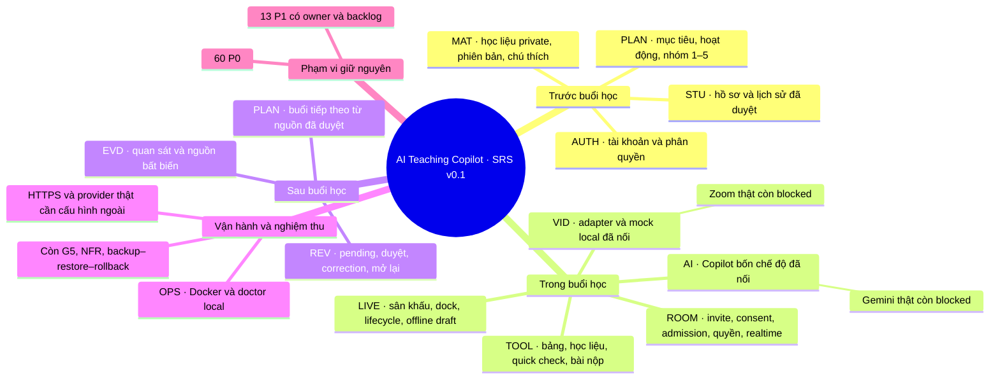

# Báo cáo triển khai ngày 01/11/2026

Docker local tại http://127.0.0.1:4170 đã chạy source này; doctor và browser classroom/AI trên gateway đều qua.

Source tích hợp: `af70f23a8cd5987c60ea7dacee523e53168f5741`. Các kết quả dưới đây thuộc môi trường local; chúng không xác nhận Google OAuth, Zoom hoặc Gemini thật.

## Đã thực hiện

| Nhóm SRS | Kết quả đã có | Giới hạn nghiệm thu |
|---|---|---|
| AUTH, STU | Backend xác thực, phiên có thể thu hồi, cách ly giáo viên; hồ sơ, lưu trữ/khôi phục và lịch sử đã duyệt | Google OAuth có mã tích hợp, thiếu credentials để chạy thật |
| MAT, PLAN | MinIO private, upload có kiểm MIME/size/hash, PDF canvas/chú thích theo trang và phiên bản; hoạt động, nhóm 1–5 học sinh, kế hoạch có nguồn | Còn kiểm tra toàn bộ tiêu chí cuối cùng trên bản release |
| LIVE, ROOM | Lời mời hash/TTL, lobby, consent, duyệt/từ chối, rotate khác revoke; quyền từng công cụ, realtime/outbox/replay và giữ draft offline | Local đã kiểm tra; chưa có bằng chứng WAN và mọi trình duyệt/thiết bị mục tiêu |
| TOOL | Bảng chung/riêng/chia sẻ, undo theo tác giả, quick check, nộp text/PDF/ảnh, chấm theo bốn mức hỗ trợ; chat cơ bản | Chat đầy đủ TOOL 006 vẫn thuộc P1 |
| EVD, REV | Nguồn có phiên bản, minh chứng theo học sinh, duyệt/sửa/từ chối, correction làm pending và mở lại review; xử lý dữ liệu lịch sử không rõ provenance | Review/RTM cuối cùng vẫn cần đối chiếu từng P0 |
| VID | MediaHost tồn tại qua đổi sân khấu; tạo/đóng phiên được tuần tự hóa; adapter dùng toolbar Zoom Toolkit; mock local có nhãn rõ | Kiểm thử contract/mock qua; Zoom cloud/camera/mic/screen share thật chưa được nghiệm thu |
| AI | Bốn chế độ trong dock giáo viên; chỉnh/dùng/bỏ qua/báo chưa phù hợp; gợi ý lưu với isObservation=false; dự thảo pending từ nguồn; giữ input/retry; kế hoạch giữ tham chiếu nguồn | Kiểm thử provider local qua; Gemini thật chưa được gọi |
| OPS | Docker PostgreSQL/MinIO/API/Caddy; doctor kiểm upload/download/quyền/CORS; request ID, audit và health | Đã backup DB và restore sang DB thử riêng; backup/restore object storage, rollback toàn bộ app và matrix NFR/a11y/G5 còn mở |

Kiểm thử supervisor trên PostgreSQL/MinIO riêng: **80 passed, 0 failed, 6 skipped**. Ba bộ Chrome classroom/media/AI đã chạy, có giáo viên và hai context học sinh độc lập, gồm viewport 360px. Các ca skipped là placeholder được ghi rõ; không tính là pass. Load baseline trước đó trên source `55c05e1`: API p95 12,81 ms và event receipt p95 15,41 ms với một giáo viên/năm học sinh; chưa phải phép đo release cuối.

Review độc lập đã bắt thêm lỗi source-ID và cleanup SDK mà fixture cũ bỏ sót. Các sửa tại af70f23 chỉ cho note mặc định version1, kiểm nguồn thật khi history/AI/approval, kiểm lại consent lịch sử, và dùng leaveSession + destroy cho ordinary teardown. Reviewer tái kiểm ba phạm vi này Scoped PASS, chạy3 test không DB; không tự gán là reviewer đã chạy toàn bộ HTTP/browser.

## Mind map theo SRS ban đầu

## Có thay đổi SRS trong lúc làm không?

**Không sửa nội dung, mức ưu tiên hoặc tiêu chí của SRS v0.1.** File DOCX gốc và generator vẫn được giữ nguyên. Những điều chỉnh sau là cách thực thi và làm rõ hợp đồng để sản phẩm đáp ứng SRS:

| Điều chỉnh | Lý do và tác động sản phẩm |
|---|---|
| Chuyển dữ liệu online từ store demo sang API/PostgreSQL, lệnh theo tài nguyên | Đa thiết bị, giữ dữ liệu sau reload/restart và kiểm quyền ở server |
| Tách link mời khỏi grant đã được admit | Rotate link không đẩy học sinh đang học ra; revoke thu hồi quyền thật |
| Quyền global là giới hạn cứng, override cá nhân chỉ thu hẹp | Không để override bật lại công cụ giáo viên đã tắt; canWrite chỉ khóa bảng |
| Row lock, kiểm tra lại nguồn/quyền trong transaction; outbox có thứ tự | Chặn race giữa kết thúc lớp, chấm lại, duyệt nhận định và phát sự kiện |
| Phân biệt evidence tự sinh với quan sát giáo viên; sửa provenance lịch sử theo hướng thận trọng | Chấm lại không ghi đè quan sát độc lập, nguồn không rõ không được hợp thức hóa |
| Dùng toolbar native của Zoom Toolkit cho mic/camera/share thật | Phù hợp hướng Toolkit đã duyệt; bỏ điều khiển wrapper giả thành công và trạng thái SDK suy đoán |
| Migration bổ sung 009/010 và biên nhận AI có nguồn | Không sửa migration 008 đã áp dụng; retry không tạo trùng hoặc làm mất nguồn kế hoạch |
| Tách local acceptance khỏi Real-HTTPS | Theo yêu cầu tiếp tục Docker khi chưa có credentials; không hạ tiêu chí nghiệm thu thật |

## Tiếp theo

1. Review độc lập các blocker đã đạt Scoped PASS; Docker chạy source af70f23 và bằng chứng runtime được lưu riêng. Tiếp tục QA cuối trên từng tiêu chí SRS.
2. Khép kín kiểm tra release local: backup/restore/rollback, NFR/a11y, matrix trình duyệt và truy vết từng tiêu chí P0.
3. Khi có cấu hình ngoài: Google OAuth thật, hai thiết bị Zoom thật, Gemini thật và VPS/domain HTTPS; chạy lại test trên release cuối.
4. Chỉ đóng G5 khi đủ bằng chứng 60/60 P0 và NFR bắt buộc. Hiện chưa đạt điều kiện này.

## Worker và nhánh

Các writer cũ đều sạch ở checkpoint đã commit; cả backend, frontend và QA Gemini đều đã báo quota thực tế. Không có API xác nhận số token còn lại. Supervisor tiếp quản integration; không có hai writer cùng sửa các file runtime. Review độc lập mới chỉ có quyền đọc.

| Nhánh | Checkpoint |
|---|---|
| `feat/integrated-classroom-ui` | `af70f23` và commit báo cáo tiếp theo |
| `workers/product-completion-20261031` | `26318dc` |
| `workers/classroom-wiring-20261101` | `fdb17d6` |
| `workers/ui-completion-20261031` | `f55ef71` |
| `workers/demo-verification-20261031` | `1501d80` |
| `workers/operations-local-20261031` | `29f97ca` |

Bản sửa cuối nằm trên nhánh supervisor; giữ nguyên checkpoint worker để không làm mất lịch sử review. Trạng thái remote phải được kiểm bằng `git ls-remote` sau push; bảng này tự nó không phải bằng chứng push.
