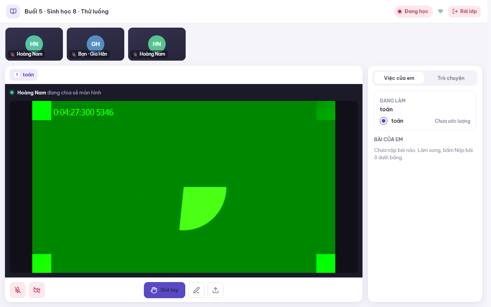
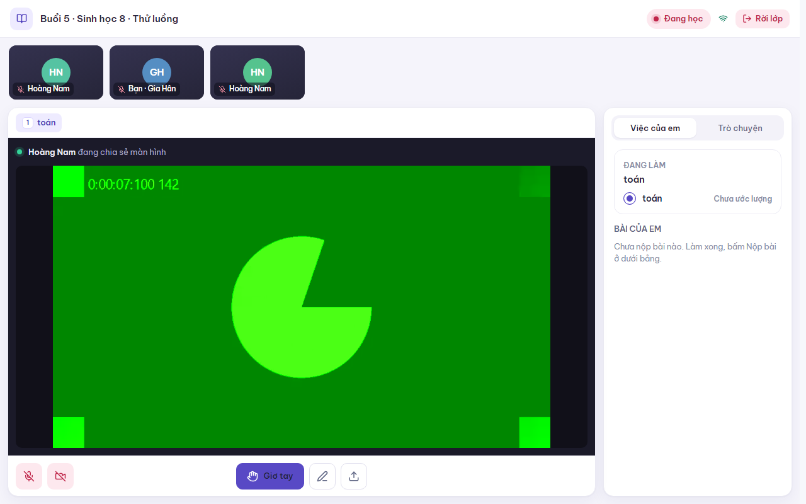

# Review UI: học sinh không xem được màn hình chia sẻ

**Trạng thái: Chờ xác minh UI**
**Người xác minh:** chưa có. Ngày xác minh và kết quả: chưa có.

## Vấn đề

Gia sư chia sẻ màn hình trong phòng dạy. Học sinh vào lớp hoặc tải lại trang **trong lúc gia sư đang chia sẻ** thì thấy dòng "Thầy cô đang chia sẻ màn hình" nhưng khung hình đen. Học sinh đã ở trong lớp trước khi gia sư bấm chia sẻ thì vẫn xem được.

## Nguyên nhân

Trong lúc `client.join()` chạy, Zoom Video SDK đã phát sự kiện `active-share-change` (và cả `user-added` cho người đang bật camera). App dựng khung xem và gọi `attachShareView` ngay, nhưng luồng media (`getMediaStream()`) chỉ được gán sau khi `join()` xong, nên lần gắn đó bị bỏ qua. Không có gì kích hoạt gắn lại, nên khung đen mãi. Ô camera của người đã bật camera trước khi mình vào lớp có cùng lỗi.

Lỗi bị giấu vì `attachShareView` báo thất bại bằng giá trị trả về (`ExecutedFailure`), còn code cũ chỉ có `.catch()`.

## Thay đổi

`src/product/media/useClassVideo.ts`:
- Thêm `streamEpoch`, tăng mỗi khi có hoặc mất luồng media. `attachVideo`, `detachVideo`, `attachShare`, `detachShare` phụ thuộc vào nó, nên các khung `SeatVideo` và `ShareVideo` tự gắn lại khi luồng sẵn sàng.
- `attachShare` ghi cảnh báo vào console khi Zoom trả về thất bại.

Không đổi bố cục hay chữ trên giao diện.

## Ảnh

Khổ 1280 × 800, giao diện sáng, phía học sinh, lớp thử "Sinh học 8 · Thử luồng". Màn hình chia sẻ là hình giả của Chrome chạy thử (cờ `--use-fake-device-for-media-stream`), không phải màn hình thật.

| Trường hợp | Trước khi sửa | Sau khi sửa |
|---|---|---|
| Học sinh tải lại trang giữa lúc gia sư đang chia sẻ | Khung đen (ảnh chụp lúc tái hiện đã bị ghi đè khi chạy lại sau khi sửa, không còn lưu) |  |
| Học sinh đang trong lớp, gia sư thoát, vào lại rồi chia sẻ lại | Xem được |  |

## Cách kiểm tra

1. Gia sư mở lớp, bấm **Chia sẻ màn hình**, chọn một cửa sổ.
2. Ở máy hoặc trình duyệt khác, học sinh mở link riêng và bấm **Vào lớp** (hoặc tải lại trang nếu đã ở trong lớp).
3. Học sinh phải thấy màn hình chia sẻ, không phải khung đen.
4. Lặp lại khi học sinh đã ở trong lớp trước rồi gia sư mới chia sẻ.

Đã chạy: hai Chrome chạy thử tách biệt (gia sư có cờ tự chọn màn hình, học sinh vào bằng link riêng), cả ba trường hợp trên; `pnpm lint` sạch, `pnpm test` 43 pass.

## Giới hạn

- Chưa thử với màn hình thật và hai thiết bị thật.
- Chưa thử kịch bản ô camera bị đen bằng camera thật; bản sửa dùng chung cơ chế nên dự kiến hết lỗi.
