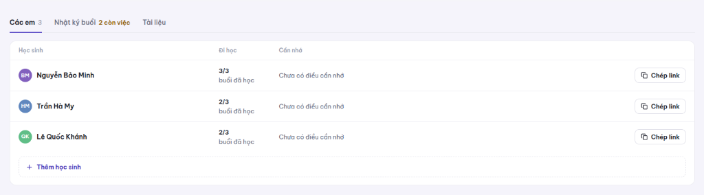
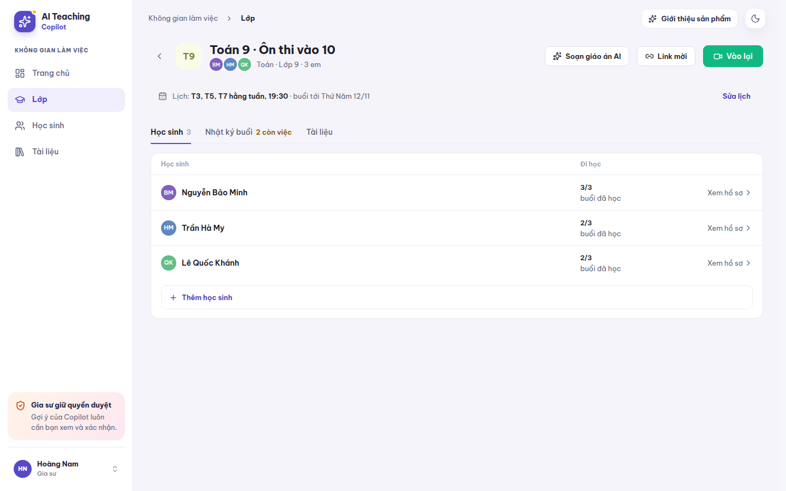
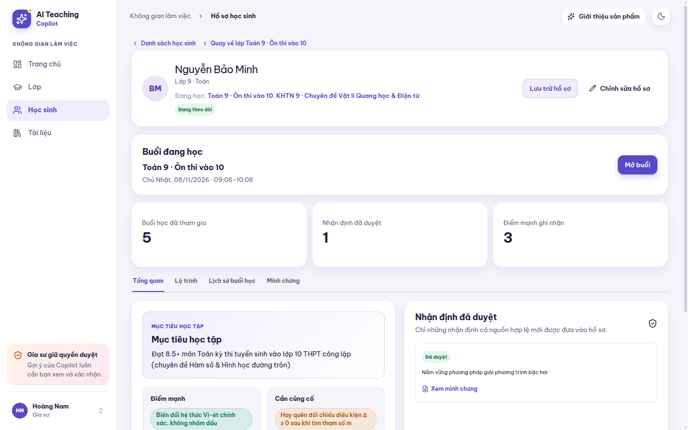
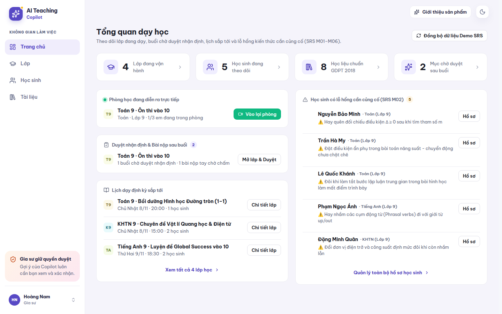
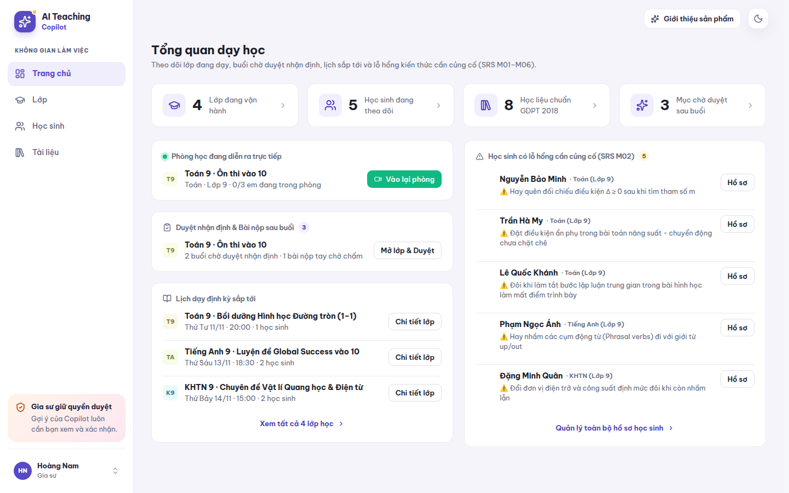

# Review UI: Đơn giản hóa bảng Học sinh trong Lớp (`ClassPage`) & Bỏ nút Đồng bộ Demo SRS trên Trang chủ (`DashboardHome`)

- **Ngày thực hiện**: 2026-11-10
- **Nhánh**: `dev`
- **Trạng thái**: `Chờ xác minh UI`
- **Người xác minh**: Chờ người dùng / reviewer xác nhận
- **Độ phân giải chụp chuẩn**: `1440x900` (Chế độ sáng)

## 1. Nhu cầu và mục tiêu thay đổi

1. **Trang Chi tiết lớp ([`ClassPage.tsx`](file:///home/quanan/AI-Teaching-Colpilot/src/product/classHome/ClassPage.tsx))**:
   - Đổi tên tab **Các em** thành **Học sinh**.
   - Xóa cột **Cần nhớ** trong bảng danh sách học sinh của lớp.
   - Xóa nút **Chép link** trên từng dòng học sinh (vẫn giữ nút **Link mời** ở thanh tiêu đề đầu trang lớp khi gia sư cần lấy link).
   - Khi ấn vào từng dòng học sinh trong bảng, điều hướng mở thẳng trang **Hồ sơ học sinh** (`page = "student"`) của em đó (có nút **Quay về lớp ...** để trở lại lớp nhanh chóng), bỏ bước trung gian mở khung trượt bên phải.
2. **Trang chủ / Tổng quan dạy học ([`DashboardHome.tsx`](file:///home/quanan/AI-Teaching-Colpilot/src/product/classHome/DashboardHome.tsx))**:
   - Loại bỏ nút **Đồng bộ dữ liệu Demo SRS** ở góc trên bên phải tiêu đề trang Tổng quan dạy học để giao diện gọn gàng và thực tế hơn.

## 2. Hành vi Trước và Sau khi sửa

| Hạng mục | Trước khi sửa | Sau khi sửa |
| --- | --- | --- |
| **Tên tab danh sách học sinh (`ClassPage`)** | `Các em` | `Học sinh` |
| **Các cột trong bảng (`ClassPage`)** | `Học sinh`, `Đi học`, `Cần nhớ`, và cột nút `Chép link` | `Học sinh`, `Đi học`, và nhãn điều hướng `Xem hồ sơ >` |
| **Thao tác bấm vào học sinh (`ClassPage`)** | Mở khung trượt (`StudentDrawer`) bên phải màn hình | Mở thẳng trang **Hồ sơ học sinh** đầy đủ (`page = "student"`) kèm lối tắt quay lại lớp |
| **Thanh tiêu đề Trang chủ (`DashboardHome`)** | Có nút `Đồng bộ dữ liệu Demo SRS` | Đã xóa nút `Đồng bộ dữ liệu Demo SRS` |

## 3. Ảnh chụp màn hình Trước và Sau

| Trạng thái | Ảnh chụp màn hình |
| --- | --- |
| **Trước khi sửa - Bảng học sinh lớp** |  |
| **Sau khi sửa - Bảng học sinh lớp** |  |
| **Sau khi sửa - Mở hồ sơ học sinh khi bấm vào dòng** |  |
| **Trước khi sửa - Trang chủ có nút Đồng bộ dữ liệu Demo SRS** |  |
| **Sau khi sửa - Trang chủ đã bỏ nút Đồng bộ dữ liệu Demo SRS** |  |

## 4. Cách sử dụng và kiểm tra

1. Mở **Trang chủ** (`http://127.0.0.1:3000`): Kiểm tra góc phải thanh tiêu đề **Tổng quan dạy học** không còn nút **Đồng bộ dữ liệu Demo SRS**.
2. Mở mục **Lớp**, chọn một lớp học (ví dụ: `Toán 9 · Ôn thi vào 10`):
   - Kiểm tra tab đầu tiên hiển thị tên **Học sinh** (kèm số lượng học sinh).
   - Kiểm tra bảng danh sách chỉ gồm cột **Học sinh**, **Đi học** và chỉ báo **Xem hồ sơ >**.
   - Bấm vào bất kỳ dòng học sinh nào -> hệ thống mở thẳng trang **Hồ sơ học sinh** đầy đủ của em đó.

## 5. Phạm vi ảnh hưởng và giới hạn còn lại

- **File thay đổi**:
  - [`src/product/classHome/ClassPage.tsx`](file:///home/quanan/AI-Teaching-Colpilot/src/product/classHome/ClassPage.tsx)
  - [`src/product/classHome/classes-v2.css`](file:///home/quanan/AI-Teaching-Colpilot/src/product/classHome/classes-v2.css)
  - [`src/product/classHome/DashboardHome.tsx`](file:///home/quanan/AI-Teaching-Colpilot/src/product/classHome/DashboardHome.tsx)
- **Giới hạn**: Trạng thái hiện tại là `Chờ xác minh UI` từ người dùng trước khi commit/push.
