# Review UI: Nâng cấp toàn diện Landing Page cho Investor Pitching (`LandingPage.tsx`)

- **Ngày thực hiện**: 2026-11-10
- **Nhánh**: `dev`
- **Trạng thái**: `Chờ xác minh UI`
- **Người xác minh**: Chờ người dùng / reviewer xác nhận
- **Độ phân giải chụp chuẩn**: `1440x900` (Chế độ Sáng & Tối)

## 1. Mục tiêu thay đổi

Nâng cấp trang giới thiệu sản phẩm ([`LandingPage.tsx`](file:///home/quanan/AI-Teaching-Colpilot/src/product/LandingPage.tsx) & [`landing-page.css`](file:///home/quanan/AI-Teaching-Colpilot/src/product/landing-page.css)) thành một **Investor Pitching Deck & Interactive Product Showcase** chuẩn mực, giúp nhà đầu tư và ban giám khảo nắm bắt ngay lập tức giá trị cốt lõi, rào cản công nghệ (Technical Moat) và bài toán kinh tế đơn vị (Unit Economics) trước khi bấm vào trải nghiệm Live Sandbox.

## 2. Các điểm nâng cấp chính (Trước vs. Sau)

1. **Hệ thống Background Đa tầng Ấn tượng (`.lp-ambient-bg` & `.lp-stage-wrap::before`)**:
   - **3 khối cầu ánh sáng Aurora (`.lp-bg-orb--1`, `--2`, `--3`)**: Phối màu Terracotta, Emerald và Indigo/Gold với độ mờ `blur(72px)`, chuyển động lơ lửng bằng `transform: translate3d(...)` trên compositor thread và dịch chuyển lệch tốc độ theo nhịp cuộn trang bằng CSS Scroll-Driven Animations (`animation-timeline: scroll(root block)`).
   - **Lưới kiến trúc Dot-Matrix (`.lp-bg-grid`)**: Lưới điểm tọa độ `32x32px` kết hợp mặt nạ `radial-gradient` tạo chiều sâu không gian mà không gây hiện tượng răng cưa (moiré).
   - **Bản đồ Chòm sao & Đường cong Toán học SVG (`.lp-bg-constellation`)**: Đồ thị đường cong Parabol nét đứt, vòng quỹ đạo đồng tâm và các nút giao điểm phát sáng chạy xuyên suốt nền trang, kèm hiệu ứng hào quang đa sắc phía sau khung buồng lái Hero và mặt kính mờ (`backdrop-filter: blur(...)`).
2. **Khu vực Hero & Interactive Classroom Cockpit**:
   - **Cột trái (Pitch & 1-Click Sandbox)**: Bổ sung nhãn `LIVE PRODUCT DEMO`, dải **3 chỉ số tác động tức thì** (`-70% thời gian soạn bài & viết báo cáo`, `100% nhận định AI có minh chứng gốc`, `2.3x biên lợi nhuận nhờ dạy nhóm 3–5 em`), và làm nổi bật thẻ **Demo Hoàng Nam (`Khuyên dùng`)** với tóm tắt dữ liệu sẵn có (`4 lớp học · 6 hồ sơ · 8 đề PDF Lớp 9`).
   - **Cột phải (Interactive Live Classroom Cockpit 3 chế độ)**: Nâng cấp từ một khung tĩnh thành buồng lái tương tác trực tiếp với **3 tab chuyển đổi**:
     - `1. Bảng nháp`: Đồ thị Parabol động và biến đổi hệ thức Vi-ét trực tiếp của học sinh.
     - `2. Nộp bài QR`: Mô phỏng luồng học sinh chụp vở bài tập từ điện thoại qua QR Handoff (`#SUB-89`).
     - `3. Duyệt AI`: Mô phỏng sổ nhận định sau buổi học với cổng kiểm duyệt HITL (`Làm tốt` / `Ôn lại`) kèm chuỗi truy vết `#OBS-204 -> #CLM-09 -> M02`.
3. **Ma trận đối sánh Trước & Sau (`#lp-thesis`)**:
   - Bổ sung bảng đối sánh trực quan giữa **Mô hình Dạy kèm Phân mảnh Hiện tại** (ghép nối thủ công Zoom + Zalo + Drive + Sổ tay, trí nhớ đứt gãy, rủi ro ảo giác ChatGPT) và **Hệ điều hành AI Teaching Copilot** (Phòng cố định mở 1 chạm, bắt minh chứng tự động trong giờ, 100% nhận định có nguồn được Gia sư duyệt).
4. **Vòng lặp Sư phạm 4 bước (`#lp-workflow`)**:
   - Bổ sung chỉ số thời gian/giá trị trên từng giai đoạn (`8 phút thay vì 45 phút`, `4-trong-1`, `0% Ảo giác`, `Lũy kế 360°`) và mã định danh pipeline (`ACT-01`, `OBS-204`, `CLM-09`, `STU-01`) chuyển cảnh mượt bằng View Transitions API.
5. **Kiến trúc Minh chứng & Spotlight Bento (`#lp-moat`)**:
   - Bổ sung sơ đồ **Evidence-Gated Pipeline 4 chặng** (`01 CAPTURE -> 02 SYNTHESIZE -> 03 HITL GATE -> 04 COMPOUND`) kết hợp hiệu ứng **Interactive Pointer Spotlight** bằng `@property` và `mask-image` theo chuẩn Modern Web Guidance.
6. **Trình mô phỏng Hiệu quả Đầu tư ROI (`#lp-roi`)**:
   - Bổ sung **3 nút cấu hình nhanh (Preset Scenarios)** cho lúc thuyết trình (`Gia sư Bán thời gian (1–1)`, `Gia sư Chuyên nghiệp (Nhóm 3)`, `Lớp Luyện thi Cấp tốc (Nhóm 5)`) bên cạnh thanh trượt tùy chỉnh.

## 3. Bảng ảnh chụp Trước và Sau (`1440x900`)

| Phân khu | Trước khi sửa | Sau khi sửa |
| --- | --- | --- |
| **1. Hero & Live Cockpit (Giao diện Sáng)** | 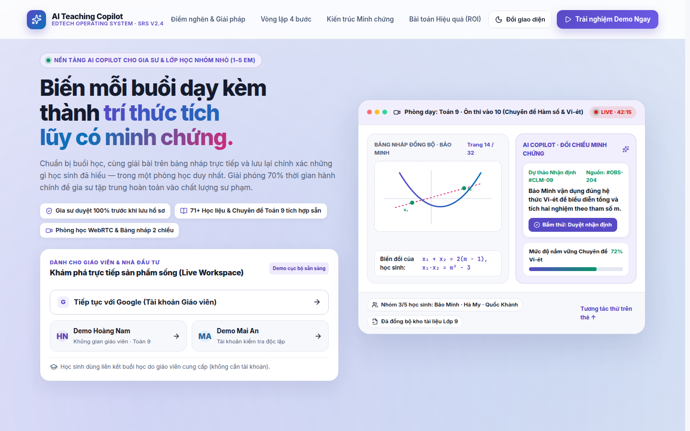 | 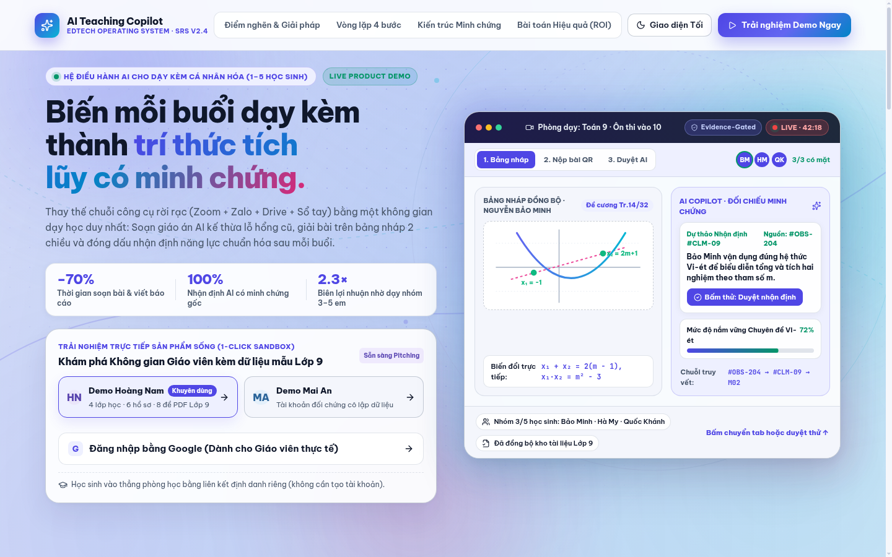 |
| **2. Hero & Live Cockpit (Giao diện Tối)** | 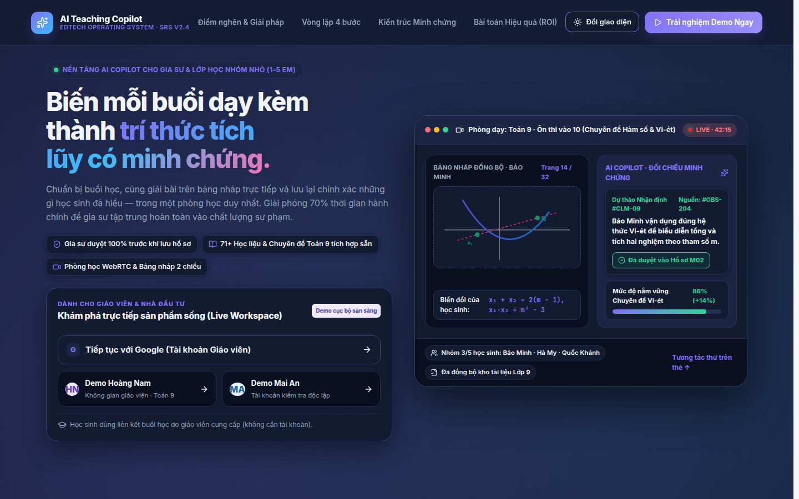 | 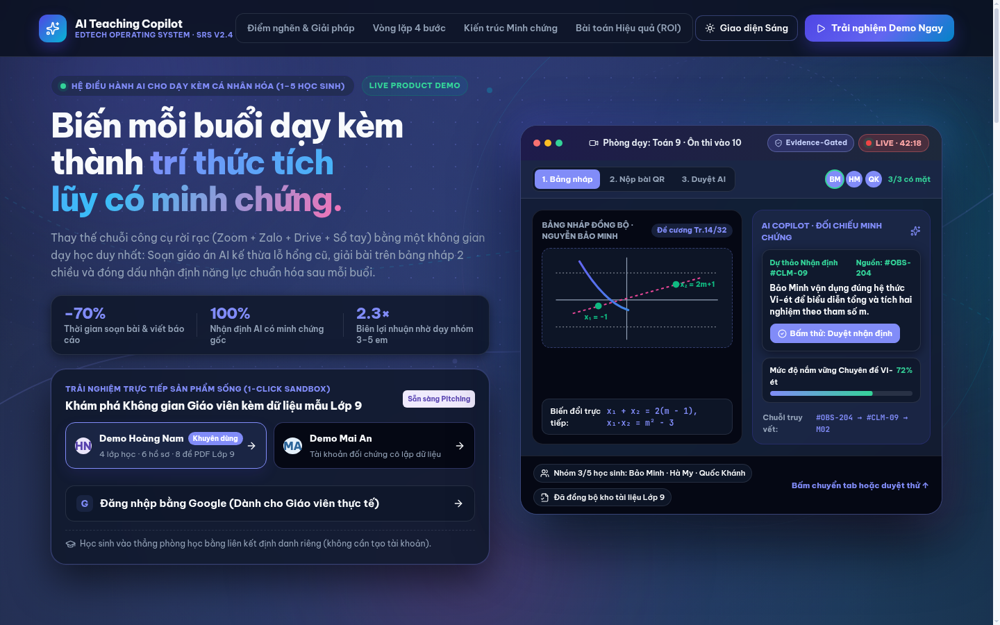 |
| **3. Điểm nghẽn & Ma trận Đối sánh** | *(Chỉ có 4 thẻ số liệu, chưa có bảng đối sánh mô hình cũ/mới)* | 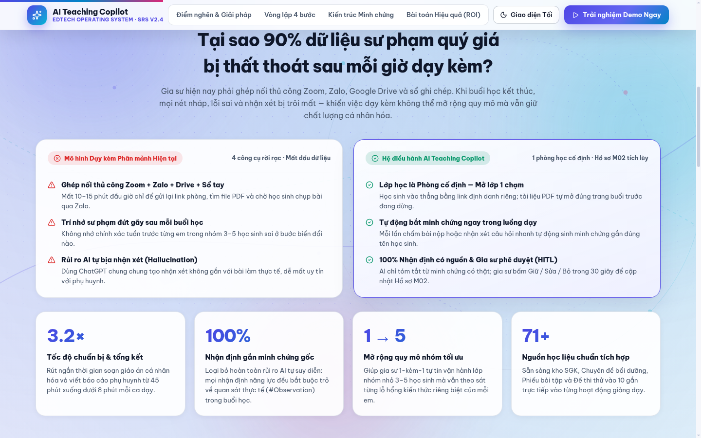 |
| **4. Vòng lặp Sư phạm 4 bước** | 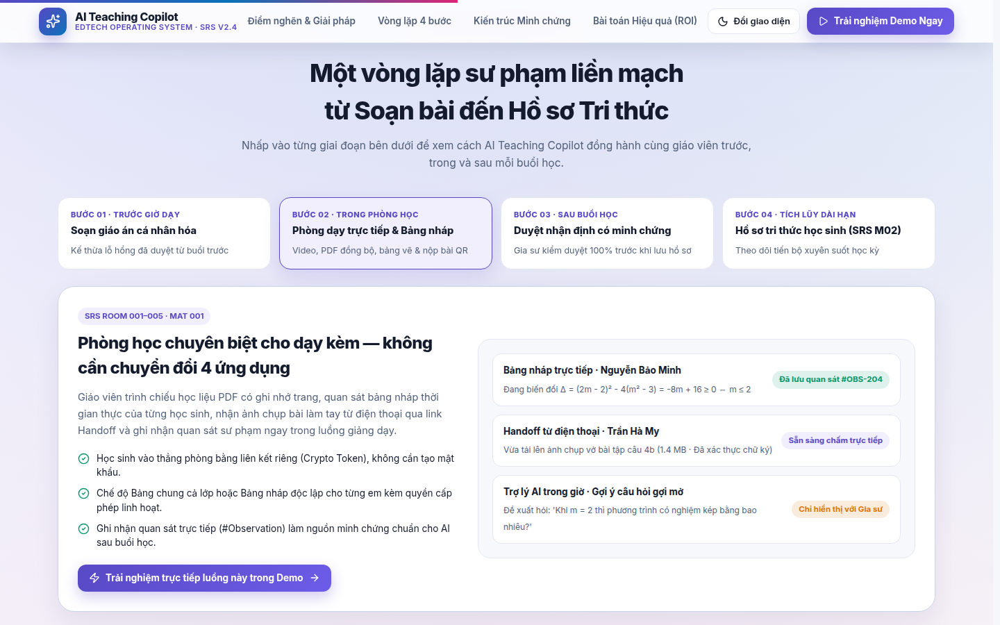 | 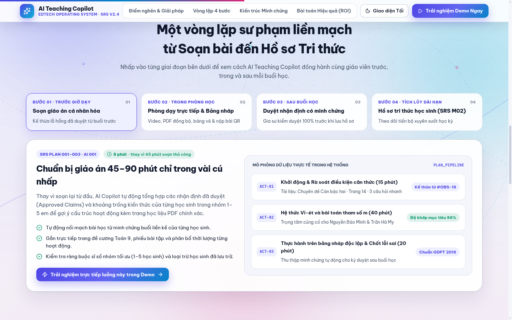 |
| **5. Kiến trúc Minh chứng & Moat Bento** | 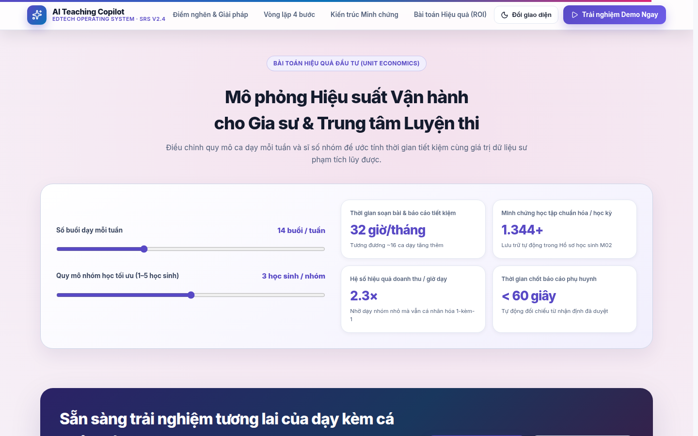 | 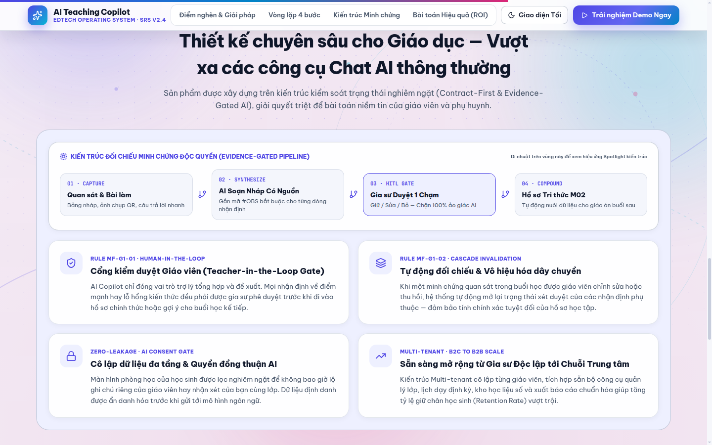 |
| **6. Mô phỏng ROI & Kịch bản Pitching** | *(Chưa có nút chọn nhanh kịch bản 1 chạm)* | 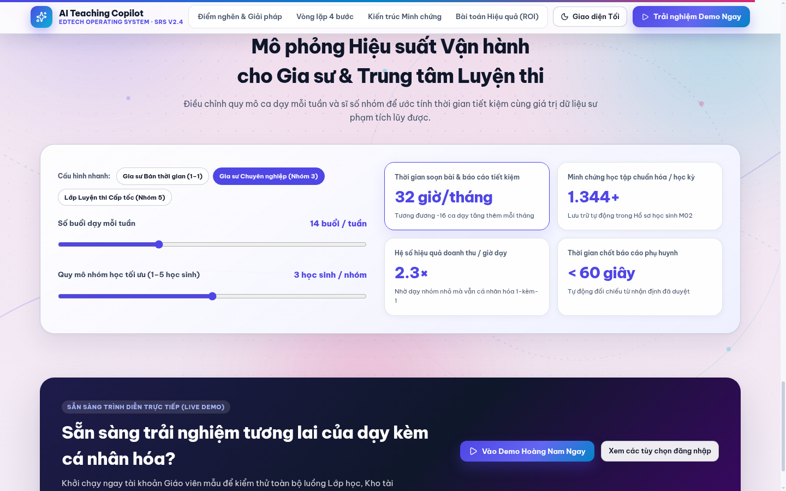 |
| **7. Điều hướng Demo / Đăng nhập vào thẳng Trang chủ (`dashboard`)** | *(Trước đây `clearWorkspace` đặt `page = "classes"` khiến sau khi đăng nhập bị nhảy vào trang Lớp thay vì Trang chủ)* | 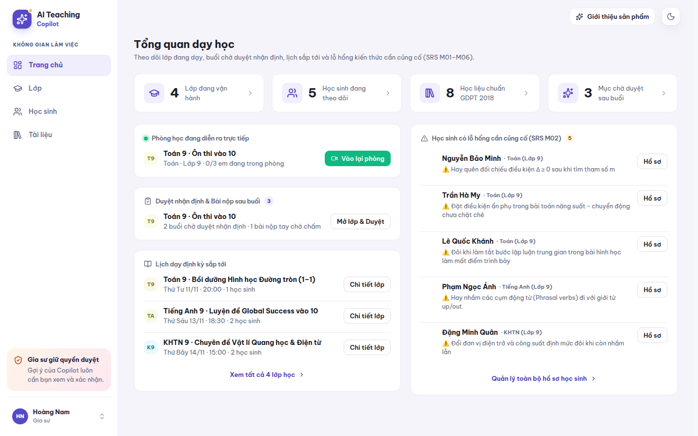 |

## 4. Cách kiểm tra và sử dụng khi Pitching

1. Mở trang giới thiệu sản phẩm (khi chưa đăng nhập hoặc bấm nút **Giới thiệu sản phẩm** trên góc phải của ứng dụng).
2. Tại **Hero**:
   - Bấm thử 3 tab `1. Bảng nháp`, `2. Nộp bài QR`, `3. Duyệt AI` và nút `Bấm thử: Duyệt nhận định` ngay trên thẻ phòng học bên phải.
   - Bấm chuyển đổi **Giao diện Tối / Giao diện Sáng** trên thanh điều hướng để trình diễn cả 2 chế độ màu.
3. Cuộn xuống **Điểm nghẽn & Giải pháp**, **Vòng lặp 4 bước**, **Kiến trúc Minh chứng** (di chuột trên khối Bento để xem hiệu ứng Spotlight) và **Bài toán Hiệu quả (ROI)** (bấm thử 3 nút kịch bản mẫu).
4. Bấm **Demo Hoàng Nam (`Khuyên dùng`)** hoặc **Trải nghiệm Demo Ngay** để vào thẳng không gian làm việc thực tế.

## 5. Rủi ro và giới hạn còn lại

- Đã giữ nguyên toàn bộ các selector kiểm thử tự động (`.restored-auth-landing`, `.demo-account`, `.google-button`, `aria-label="Demo Hoàng Nam"`, `aria-label="Demo Mai An"`).
- Trạng thái hiện tại: `Chờ xác minh UI` từ người dùng.
